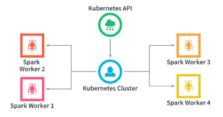

# Streaming Dataframes, Views, and Spark SQL
## 1. Importance of Spark
* **Spark**: Open-source framework for distributed computing across a cluster of servers. Spark supports Python, Scala, Java, and R.
    - Using information from a variety of sources, Spark allows you to create relationships with other data.
    - Spark reads streams of information in near real-time.
    - Spark can read from folders, sockets, or Kafka topics.
* **Cluster**: A group of 2 or more interconnected computers (nodes) that work together as a single system to provide high availability, fault tolerance, or increased capacity through load balancing or parallel processing.
    - **Standlone Cluster Mode**:A configuration in which the Spark workers are managed by the Spark Master. 
    - **Kubernets Cluster Mode**: A configuration in which Spark workers are managed by Kubernetes.   
* **Kubernetes**: An open-source container orchestration platform that automates deployment, scaling, and management of containerized applications.

* **Kafka**: Durable message broker used to mediate the exchange of messages between multiple applications.

Spark Sources:
* Kafka
* Folder
* Socket

## 2. Run a Spark Cluster and Spark Applications
Spark streaming application - Databricks:
```py
# Step 1: Read streaming data from Kafka
kafkaRawStreamingDF = (
    spark.readStream
    .format("kafka")
    .option("kafka.bootstrap.servers", "YOUR_KAFKA_BROKER:9092")
    .option("subscribe", "balance-updates")
    .option("startingOffsets", "earliest")
    .load()
)

# Step 2: Convert Kafka key and value from binary to string
kafkaStreamingDF = kafkaRawStreamingDF.selectExpr(
    "CAST(key AS STRING) AS key",
    "CAST(value AS STRING) AS value"
)

# Step 3: Display streaming data in Databricks
display(kafkaStreamingDF)
```

For example, imagine you have a log file and want to monitor new log entries in real time as they are generated using Spark Structured Streaming.

Another example is analyzing incoming text data to count how many times the letters 'a' and 'b' appear, continuously updating the counts as new text arrives.

## 3. Stream Dataframes with a Kafka Source
* **Source**: An external system that generates data.
* **Sink**: An external system that consumes data.
* **Offset**: in a Kafka configuration, a unique sequential ID assigned to each message within a partition, representing its position. Consumers use offsets to track which messages have been read. The terms `earliest` and `latest` refer to consumer settings that determine whether consumption starts from the oldest or newest message.
* Every message you read from Kafka has 2 fields:
    - They **Key** column is like the primary key for a database table and is often a unique identifier.
    - The **Value** column contains the bulk of the data being transmitted.

```py
# Step 1: Read events from Kafka
kafkaRawStreamingDF = (
    spark.readStream
    .format("kafka")
    .option("kafka.bootstrap.servers", "YOUR_KAFKA_BROKER:9092")
    .option("subscribe", "balance-updates")
    .option("startingOffsets", "earliest")
    .load()
)

# Step 2: Convert Kafka key and value to strings
kafkaStreamingDF = kafkaRawStreamingDF.selectExpr(
    "CAST(key AS STRING) AS key",
    "CAST(value AS STRING) AS value"
)

# Step 3: Display streaming events in Databricks
display(kafkaStreamingDF)
```

## 4. Create and Query a Spark View
**Spark View**: A Spark View is a logical table defined by a SQL query in a Spark application. It can be temporary (session-scoped) or global (available across sessions), providing a way to represent data without storing it physically. For example, a view of discounted inventory.

This example is the opposite of the previous one. Instead of reading data from Kafka, we're going to write streaming data to Kafka using Databricks.
```py
# STEP 1: Read data from the FuelLevel temporary view
# This view must already exist in your Spark session.
# It should contain columns named 'key' and 'value'.

fuelLevelDF = spark.sql("""
    SELECT key, value
    FROM FuelLevel
""")


# STEP 2: Prepare the data for Kafka
# Kafka expects the message key and value to be
# strings or binary data.
# Convert both columns into strings.

fuelLevelKeyValueDF = fuelLevelDF.selectExpr(
    "CAST(key AS STRING) AS key",
    "CAST(value AS STRING) AS value"
)


# STEP 3: Write streaming events to Kafka
# This requires fuelLevelKeyValueDF to be a streaming
# DataFrame, not a regular batch DataFrame.

query = (
    fuelLevelKeyValueDF.writeStream

    # Set Kafka as the destination (sink)
    .format("kafka")

    # Specify the Kafka broker address.
    # Replace with a broker reachable from Databricks.
    .option("kafka.bootstrap.servers", "YOUR_KAFKA_BROKER:9092")

    # Publish messages to the "fuel-changes" Kafka topic
    .option("topic", "fuel-changes")

    # Store streaming progress and offsets.
    # Use a persistent Unity Catalog volume for checkpoints.
    .option(
        "checkpointLocation",
        "/Volumes/main/default/checkpoints/fuel_changes"
    )

    # Start the streaming query
    .start()
)

# STEP 4: Check whether the stream is running
print(query.isActive)

# Optional: Stop the stream when finished
# query.stop()
```

